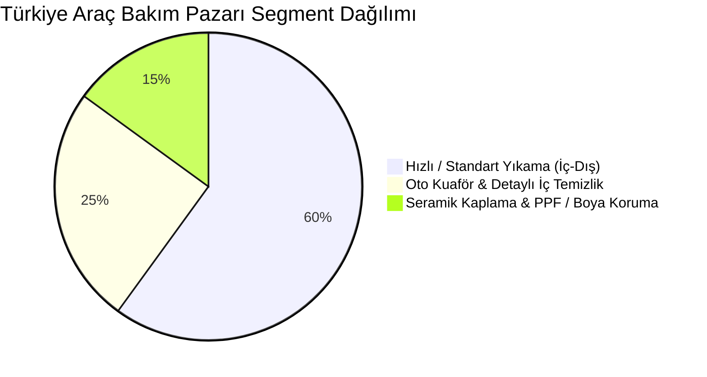
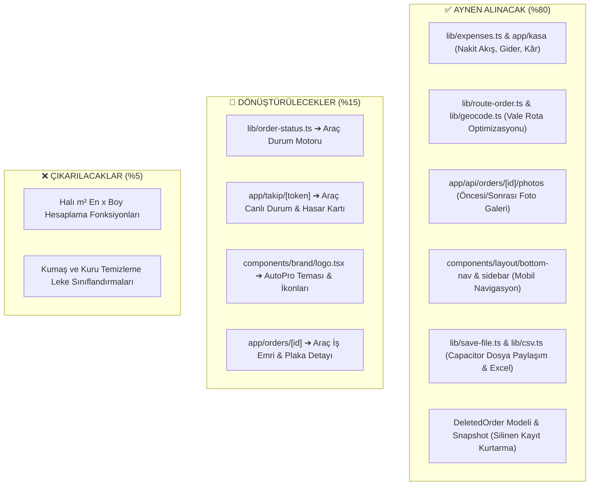
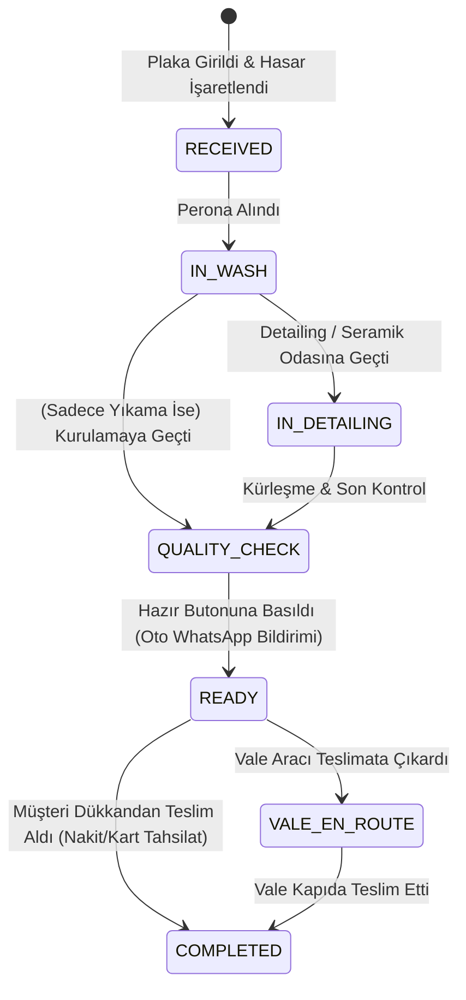
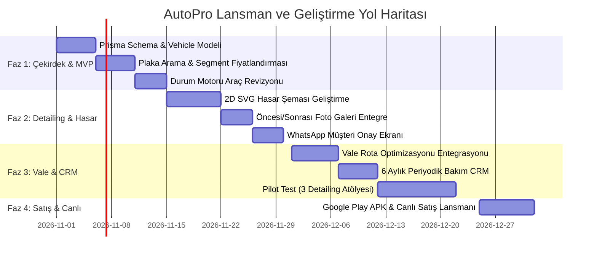

# 🚗 AutoPro: Oto Yıkama, Detailing & Vale Hizmetleri Master Planı
### *LaundryPro Çekirdek Altyapısından Sektör Lideri Bir Auto-Detailing SaaS Platformuna Dönüşüm Kılavuzu*

---

## 📑 İÇİNDEKİLER
1. [Sektörün Mevcut Durumu ve Pazar Dinamikleri](#1-sektörün-mevcut-durumu-ve-pazar-dinamikleri)
2. [Yerli ve Küresel Rakiplerin Derinlemesine Analizi (Benchmarking)](#2-yerli-ve-küresel-rakiplerin-derinlemesine-analizi-benchmarking)
3. [Esnafın ve Detailing Merkezlerinin En Büyük 7 Acı Noktası (Pain Points)](#3-esnafın-ve-detailing-merkezlerinin-en-büyük-7-acı-noktası-pain-points)
4. [LaundryPro Kod Tabanımızın Dosya Dosya Mimari Haritası](#4-laundrypro-kod-tabanımızın-dosya-dosya-mimari-haritası)
5. [Tam Veritabanı Modeli (Prisma Schema Tasarımı)](#5-tam-veritabanı-modeli-prisma-schema-tasarımı)
6. [Durum ve İş Akış Motoru (State Machine Tasarımı)](#6-durum-ve-iş-akış-motoru-state-machine-tasarımı)
7. [AutoPro'ya Özel Geliştirilecek 5 Kritik Modülün Teknik Tasarımı](#7-autoproya-özel-geliştirilecek-5-kritik-modülün-teknik-tasarımı)
8. [Kullanıcı Arayüzü ve Ekran Akışları (UI/UX Blueprint)](#8-kullanıcı-arayüzü-ve-ekran-akışları-uiux-blueprint)
9. [Ticari Strateji, Fiyatlandırma ve Pazara Giriş (Go-to-Market)](#9-ticari-strateji-fiyatlandırma-ve-pazara-giriş-go-to-market)
10. [90 Günlük Adım Adım Uygulama Yol Haritası](#10-90-günlük-adım-adım-uygulama-yol-haritası)

---

## 1. Sektörün Mevcut Durumu ve Pazar Dinamikleri

Türkiye'de kayıtlı yaklaşık **35.000+ oto yıkama, oto kuaför ve detailing merkezi** bulunmaktadır. Son 5 yılda otomobil fiyatlarının astronomik artışıyla birlikte araç sahipleri araçlarını bir yatırım aracı olarak görmeye başlamış ve sektör iki ana segmente bölünmüştür:



1. **Hızlı Yıkama (Hacim Odaklı):** Günde 40-150 araç yıkayan, işlem süresi 20-35 dakika olan, ortalama araç başı 300 - 600 ₺ ciro üreten işletmeler. Burada en kritik ihtiyaç: **Işık hızında araç kabulü (10 saniye), plaka tanıma ve hızlı kasa/fiş.**
2. **Detailing & PPF Stüdyoları (Değer Odaklı):** Günde 2-6 araç alan, aracın 1 ila 4 gün dükkanda kaldığı, sepet ortalaması **10.000 ₺ ile 80.000 ₺** arasında değişen yüksek marjlı işletmeler. Burada en kritik ihtiyaç: **Kusursuz araç kabul hasar çizik şeması, lift randevusu, WhatsApp durum bilgilendirmesi ve müşteri güveni.**

---

## 2. Yerli ve Küresel Rakiplerin Derinlemesine Analizi (Benchmarking)

Pazardaki yerli çözümler ve küresel standartları belirleyen ABD/Avrupa SaaS oyuncuları detaylı incelenmiştir:

| Yazılım | Ülke / Pazar | Güçlü Yönleri | Zayıf Yönleri / Esnaf Şikayetleri | Fiyatlandırma |
| :--- | :---: | :--- | :--- | :--- |
| **HizmetPro** | 🇹🇷 Türkiye | Pazar bilinirliği yüksek, çoklu şube desteği var. | Arayüzü eski ve hantal; mobil uygulaması webview sarmalaması olduğu için sahada donuyor; vale rota optimizasyonu yok. | Yıllık 8.000 ₺ - 18.000 ₺ |
| **Detailing.app** | 🇹🇷 Türkiye | Teklif hazırlama, modern web arayüzü, görsel tasarım. | Küçük ve orta ölçekli esnafa çok karmaşık geliyor; hızlı yıkama için aşırı yavaş; vale/kurye lojistiği yok. | Aylık 900 ₺ - 2.000 ₺ |
| **Carmek** | 🇹🇷 Türkiye | WhatsApp/SMS gönderimi, plaka bazlı müşteri kartı. | Finansal kasa defteri zayıf; araç hasar çizik haritası yok; teknolojik altyapısı eski. | Aylık 600 ₺ - 1.200 ₺ |
| **Cleandy** | 🇹🇷 Türkiye | Çoklu hizmet ekleme, segment fiyatlandırması. | Rota planlama sıfır; mobil uygulama performansı düşük; müşteri sadakat otomasyonu yetersiz. | Aylık 750 ₺ |
| **Urable** *(Benchmark)* | 🇺🇸 Global | Dünyanın en iyi detailing yazılımı; interaktif 3D/2D hasar haritası, mükemmel mobil UX. | Türkiye pazarına tamamen kapalı (Türkçe yok, TL yok, WhatsApp yok, yerel fatura yok), aşırı pahalı. | Aylık 79 $ - 199 $ |
| **Mobile Tech RX** | 🇺🇸 Global | Dolu hasarı, göçük düzeltme ve detailing teklif motoru. | Yalnızca ABD sigorta ve fatura standartlarına göre tasarlanmış. | Aylık 120 $+ |

### 🎯 AutoPro'nun Pazardaki Benzersiz Konumu (Moat / USP):
* **Next.js 15 + Tailwind CSS ile Sıfır Gecikme:** Rakiplerin hantal arayüzlerine karşı saniyeler içinde açılan, cepten ve tabletten yağ gibi akan PWA/Native mobil deneyim.
* **Akıllı Vale & Rota Motoru:** Türkiye'de hiçbir oto yıkama programında olmayan **TSP (Gezgin Satıcı) Rota Planlaması**. (VIP müşterinin evinden araç alıp, işlem bitince geri bırakma rotası).
* **Üyeliksiz WhatsApp Takip:** Müşteri hiçbir uygulama indirmeden WhatsApp linkinden aracının hangi aşamada olduğunu ve kabul fotoğraflarını canlı görür.

---

## 3. Esnafın ve Detailing Merkezlerinin En Büyük 7 Acı Noktası (Pain Points)

1. **"Bu Çizik Sizde Oldu" Kavgası:** Müşteri 30.000 TL verip seramik yaptırdığı aracın kapısındaki eski taş izini teslim alırken fark eder ve *"Siz yaptınız, boyatın"* der. Önceden kayıtlı hasar belgesi yoksa esnaf zarar yazar.
2. **Kasa Kaçağı ve Eleman Takipsizliği:** Günde 80 araç yıkanan dükkanda çırakların hangi araçtan nakit alıp cebe attığı takip edilemez.
3. **Telefon Kirliliği:** *"Usta benim araba ne zaman çıkar?"* diye günde 50 telefon gelir; ustalar telefon açmaktan iş yapamaz.
4. **Segment Fiyat Farkı Tartışması:** Sedan ile dev SUV'ye aynı şampuan ve işçilik harcanamaz. Manuel fiyatlamada elemanlar hata yapar.
5. **Lift/Peron Çakışması:** Seramik kaplama 2 gün sürer. Aynı güne 3 seramik işi alıp aracı dışarıda yağmur altında bekletmek müşteri kaybettirir.
6. **Müşteriyi Geri Getirememe (Unutulan Bakımlar):** Seramik yapılan araç 6 ay sonra kontrole gelmelidir. Defterde kalan müşteriler unutulur, rakibe gider.
7. **Usta Prim Hesabı:** Hangi ustanın hangi araca pasta-cila attığı, kaç para prim hak ettiği ay sonunda büyük bir kavga konusudur.

---

## 4. LaundryPro Kod Tabanımızın Dosya Dosya Mimari Haritası

Mevcut projemizin hangi parçalarını doğrudan alıyoruz, hangilerini çöpe atıyoruz, hangilerini dönüştürüyoruz?



---

## 5. Tam Veritabanı Modeli (Prisma Schema Tasarımı)

Mevcut `prisma/schema.prisma` dosyamıza entegre edilecek nihai veritabanı şeması:

```prisma
// ==========================================
// 1. ARAÇ (VEHICLE) MODELİ
// ==========================================
model Vehicle {
  id            String          @id @default(uuid())
  businessId    String          @map("business_id")
  customerId    String          @map("customer_id")
  plateNumber   String          @map("plate_number") // Örn: "34 ABC 789" (Boşluksuz ve standart format)
  brand         String                               // Örn: "BMW"
  model         String                               // Örn: "320i"
  year          Int?                                 // Örn: 2023
  color         String?                              // Örn: "Safir Siyah"
  segment       VehicleSegment  @default(SEDAN)
  mileage       Int?                                 // Kabul anındaki km
  fuelLevel     String?         @map("fuel_level")   // "1/4", "1/2", "Full"
  chassisNo     String?         @map("chassis_no")   // Şasi No (Opsiyonel)
  notes         String?         @db.Text
  createdAt     DateTime        @default(now()) @map("created_at")
  updatedAt     DateTime        @updatedAt @map("updated_at")

  customer      Customer        @relation(fields: [customerId], references: [id], onDelete: Cascade)
  orders        Order[]

  @@unique([businessId, plateNumber])
  @@index([businessId, plateNumber])
  @@map("vehicles")
}

enum VehicleSegment {
  HATCHBACK      // A-B Segment (Polo, Clio, i20)
  SEDAN          // C-D-E Segment (Corolla, Passat, 320i)
  SUV_COMPACT    // B-C SUV (Qashqai, T-Roc, 3008)
  SUV_LARGE      // D-E SUV / Pick-up (Range Rover, Hilux, X5)
  COMMERCIAL     // Ticari / Minibüs (Transporter, Vito, Crafter)
  MOTORCYCLE     // Motosiklet
}

// ==========================================
// 2. HASAR & ÇİZİK RAPORU (VEHICLE INSPECTION)
// ==========================================
model VehicleInspection {
  id            String    @id @default(uuid())
  orderId       String    @unique @map("order_id")
  inspectorId   String?   @map("inspector_id") // Aracı teslim alan personel
  damageItems   Json      // [{ id: 1, part: "right_front_door", type: "scratch", severity: "deep", note: "Derin çizik" }]
  customerApproved Boolean @default(false) @map("customer_approved") // Müşteri WhatsApp'tan onayladı mı?
  signatureUrl  String?   @map("signature_url") // Müşterinin ekrandan attığı ıslak imza
  createdAt     DateTime  @default(now()) @map("created_at")

  order         Order     @relation(fields: [orderId], references: [id], onDelete: Cascade)
  @@map("vehicle_inspections")
}

// ==========================================
// 3. İSTASYON / LİFT MODELİ (STATIONS)
// ==========================================
model Station {
  id            String       @id @default(uuid())
  businessId    String       @map("business_id")
  name          String                            // Örn: "Peron 1 (Yıkama)", "Lift 2 (Seramik Odası)"
  type          StationType  @default(WASH_BAY)
  isActive      Boolean      @default(true) @map("is_active")

  orders        Order[]

  @@map("stations")
}

enum StationType {
  WASH_BAY       // Standart Yıkama Peronu
  DRYING_BAY     // Kurulama & İç Temizlik Alanı
  DETAILING_ROOM // Tozsuz Seramik & PPF Odası
  LIFT           // Mekanik / Alt Yıkama Lifti
}

// ==========================================
// 4. PERİYODİK BAKIM HATIRLATICI (MAINTENANCE CRM)
// ==========================================
model MaintenanceReminder {
  id            String          @id @default(uuid())
  businessId    String          @map("business_id")
  vehicleId     String          @map("vehicle_id")
  customerId    String          @map("customer_id")
  serviceType   String          @map("service_type")   // "Seramik Kaplama Kontrolü", "Klima Ozon Temizliği"
  dueDate       DateTime        @map("due_date")       // Hatırlatma tarihi (örn: 6 ay sonra)
  status        ReminderStatus  @default(PENDING)
  channel       String          @default("WHATSAPP")   // "WHATSAPP", "SMS"
  sentAt        DateTime?       @map("sent_at")
  createdAt     DateTime        @default(now()) @map("created_at")

  @@index([businessId, dueDate, status])
  @@map("maintenance_reminders")
}

enum ReminderStatus {
  PENDING
  SENT
  COMPLETED
  CANCELLED
}
```

---

## 6. Durum ve İş Akış Motoru (State Machine Tasarımı)

`lib/order-status.ts` dosyamız AutoPro için şu durumlara göre konfigüre edilir:

```ts
export const AUTO_STATUS = {
  RECEIVED: "RECEIVED",           // Araç Giriş Yaptı & Hasar Kaydı Alındı
  IN_WASH: "IN_WASH",             // Yıkama Peronunda (Dış / Alt Yıkama)
  IN_DETAILING: "IN_DETAILING",   // Detailing / Kuaför / Seramik Uygulamasında
  QUALITY_CHECK: "QUALITY_CHECK", // Son Kontrol & Kurulama
  READY: "READY",                 // Teslime Hazır (Müşteriye "Aracınız Hazır" WhatsApp bildirimi gider)
  VALE_EN_ROUTE: "VALE_EN_ROUTE", // Vale Adrese Teslimata Çıktı (Harita Rota Linki)
  COMPLETED: "COMPLETED",         // Müşteriye Teslim Edildi & Ödeme Kapatıldı
  CANCELLED: "CANCELLED",         // İptal Edildi
} as const;
```



---

## 7. AutoPro'ya Özel Geliştirilecek 5 Kritik Modülün Teknik Tasarımı

### 🎯 Modül 1: 2D İnteraktif Kaporta Hasar & Kusur Haritası
* **Teknoloji:** SVG tabanlı Sedan/SUV vektör çizimi (Üstten, Sağdan, Soldan, Önden, Arkadan görünüm).
* **Çalışma Şekli:**
  1. Usta tableti eline alır, arabanın etrafında 1 tur döner.
  2. Sol ön çamurluğa tıklar ➔ Mini açılır menü: `[Çizik]`, `[Göçük]`, `[Boya Atması]`, `[Taş İzi]`.
  3. Hemen `Fotoğraf Çek` butonuna basar; kameradan çizik yakından fotoğraflanır.
  4. Araç kabul tamamlandığında bu rapor PDF ve WhatsApp linki olarak müşteriye gider: *"Sayın Can Bey, aracınızın kabul sırasındaki mevcut 3 adet kaporta kusuru kayda geçmiştir. İncelemek için tıklayın."*
* **Faydası:** Yıllık en az 50.000 TL – 100.000 TL'lik haksız hasar tazminatını önler.

### 🎯 Modül 2: Araç Segmenti Dinamik Fiyatlandırma Motoru
* Tek bir ürün/hizmet tanımlanır (Örn: `Detaylı İç Kuaför`).
* Sistem segment bazlı katsayıları otomatik çarpar:
  $$\text{Fiyat} = \text{Hizmet Taban Fiyatı} \times \text{Segment Katsayısı}$$
* **Örnek Katsayı Matrisi:**
  * Sedan: $1.0\times$ (1.500 ₺)
  * Hatchback: $0.9\times$ (1.350 ₺)
  * C-SUV: $1.25\times$ (1.875 ₺)
  * Büyük SUV / Pick-up: $1.5\times$ (2.250 ₺)
  * Minibüs / Transporter: $1.8\times$ (2.700 ₺)

### 🎯 Modül 3: Vale Hizmeti İçin Akıllı 2 Ayaklı Rota Optimizasyonu
* LaundryPro'da yazdığımız `lib/route-order.ts` (2-opt TSP algoritması) aynen kullanılır.
* **Farkı:** İki bacaklı çalışır:
  * **Sabah Bacağı (Pickup):** Vale servis aracı sabah 08:30'da çıkar, 6 farklı plazadan 6 aracı sırayla toplar veya valeler müşterinin araçlarını dükkana getirir.
  * **Akşam Bacağı (Dropoff):** Yıkanan ve seramik yapılan araçlar mesai bitiminde müşterilerin adreslerine en az trafik ve kilometreyle teslim edilir.

### 🎯 Modül 4: Canlı Müşteri WhatsApp Takip Portalı (`/takip/[token]`)
Müşterinin telefonunda açılan web portalında:
1. **Canlı Durum Çubuğu:** Aracınız şu anda: `Kurulama ve Wax Aşamasında`.
2. **Kabul Hasar Raporu:** Girişteki işaretli çiziklerin fotoğrafları.
3. **Uygulama Öncesi & Sonrası Fotoğraflar:** Pasta-cila öncesi mat boya ile sonrası ayna gibi yansımanın yan yana karşılaştırması (slider).
4. **Şeffaf Fiş & Online Tahsilat:** Yapılan işlemler, kullanılan marka (Örn: *Gyeon Q2 Seramik*), kalan bakiye ve IBAN/Kredi Kartı butonu.

### 🎯 Modül 5: WhatsApp Destekli 6 Aylık Sadakat CRM Motoru
* Cron job her gece çalışır (`scripts/maintenance-cron.mjs`).
* Tam 180 gün önce seramik kaplama veya klima temizliği yaptıran araçları bulur.
* Esnafın paneline tek tıkla gönderilmeye hazır WhatsApp butonu düşer:
  > *"Sayın Can Bey, 34 ABC 789 plakalı aracınızın seramik kaplama 6. ay hidrofobik kontrol ve koruma yıkama zamanı gelmiştir. Bu hafta içi randevu oluşturarak parlaklığı ilk günkü haline getirebilirsiniz. AutoPro Detailing"*

---

## 8. Kullanıcı Arayüzü ve Ekran Akışları (UI/UX Blueprint)

```text
+-----------------------------------------------------------------------+
|  [🚗 AutoPro]  34 ABC 789  (BMW 320i - Sedan)          [Kabulü Bitir] |
+-----------------------------------------------------------------------+
|  Müşteri: Mehmet Yılmaz (0532 111 22 33)           İstasyon: Peron 1  |
+-----------------------------------------------------------------------+
|  [HİZMET SEÇİMİ]                   | [2D HASAR İŞARETLEME]            |
|  [X] İç-Dış Yıkama     (460 ₺)     |      /-------\                   |
|  [X] Motor Koruma      (600 ₺)     |     /  [!]    \   <- Taş İzi     |
|  [X] Ozon Dezenfeksiyon(350 ₺)     |    |   ÖN KAPOT|                 |
|  [ ] Seramik Kaplama  (12.000 ₺)   |    |           |                 |
|                                    |    |[X]     [ ]|  <- Sol Kapı    |
|  Segment: SEDAN (Katsayı: 1.0)     |    |   KABİN   |     Derin Çizik |
|                                    |    \           /                 |
|  TOPLAM TUTAR: 1.410 ₺             |     \--[!]----/   <- Arka Tampon |
|  [Nakit] [Kredi Kartı] [Veresiye]  |  [+ Fotoğraf Ekle (3 Foto Var)]  |
+-----------------------------------------------------------------------+
|  [Yazdır: Dikiz Aynası Fişi]   [Müşteriye WhatsApp Onay Linki Gönder] |
+-----------------------------------------------------------------------+
```

---

## 9. Ticari Strateji, Fiyatlandırma ve Pazara Giriş (Go-to-Market)

Detailing atölyelerinin aylık işlem hacmi ve kârlılığı yüksek olduğu için SaaS yazılımlarına para ödeme dirençleri çamaşırhanelere göre çok daha düşüktür.

### 💰 Aylık Abonelik Paketleri:
1. **AutoPro Lite (Standart Oto Yıkama):** **650 ₺ / ay**
   * Plaka bazlı araç kabulü, SMS/WhatsApp araç hazır bildirimi, hızlı kasa defteri ve dikiz aynası fiş çıktısı.
2. **AutoPro Pro (Oto Kuaför & Detailing):** **1.350 ₺ / ay**
   * Lite özelliklerine ek olarak: **2D Araç Hasar Çizik Haritası**, Öncesi/Sonrası Fotoğraf Galerisi, 6 Aylık Sadakat CRM Motoru, Usta Prim Takibi.
3. **AutoPro Enterprise (Büyük İstasyonlar & Vale):** **2.400 ₺ / ay**
   * Pro özelliklerine ek olarak: **Akıllı Vale Rota Planlama**, Çoklu Peron/Lift Yönetimi, Sınırsız Personel ve Çoklu Şube Desteği.

### 🎯 Satış ve Pazarlama Kanalları:
* **Oto Sanayi Siteleri ve AVM Vale Ziyaretleri:** Tablet ile 5 dakikalık canlı demo: *"Abi bak plakayı yazıyorsun, arabanın üstündeki çiziği işaretleyip WhatsApp'tan müşteriye atıyorsun, müşteri sana 'bu çizik sizde oldu' diyemiyor."* Bu argüman 10 esnafın 8'ine anında satış yaptırır.
* **Detailing Forumları ve Instagram Grupları:** Instagram'da reklam: *"Kaybolan araç kabul fişlerine ve çizik tartışmalarına son."*
* **Oto Bakım Kimyasalı Toptancıları:** Şampuan, cila, pasta satan bölge toptancılarıyla bayilik/komisyon anlaşması.

---

## 10. 90 Günlük Adım Adım Uygulama Yol Haritası



---

## 🏁 Sonuç ve Değerlendirme

LaundryPro'da sıfırdan inşa ettiğimiz rota motoru, kasa defteri, soft-delete güvenliği, native termal fiş altyapısı ve WhatsApp canlı takip mimarisi sayesinde **AutoPro projesinin %80'i teknik olarak zaten tamamlanmış durumdadır.**

Geriye kalan %20'lik geliştirme (Plaka kartı, 2D hasar haritası ve segment fiyatlaması) tamamlandığında, elinizde hem LaundryPro (Çamaşırhane/Halı) hem de AutoPro (Oto Detailing) olmak üzere **yıllık milyonlarca lira SaaS geliri üretme potansiyeline sahip iki devasa dikey yazılım** olacaktır.
