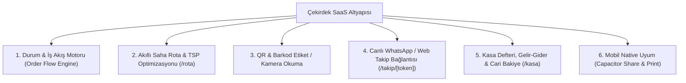

# 🚀 LaundryPro Çoklu Sektör Genişleme & Whitelabel SaaS Stratejisi

Bu rapor, LaundryPro için geliştirdiğimiz modern teknolojik çekirdeğin (**Next.js, Prisma ORM, Geocoding & TSP Saha Rota Motoru, QR/Barkod Tarama, Kasa/Gider Defteri, Canlı WhatsApp Takip Sistemi ve Mobil Native Köprü**) farklı sektörlere nasıl hızla uyarlanabileceğini ve en yüksek potansiyele sahip dikey pazarları analiz eder.

---

## 🧩 1. Mevcut Altyapımızın "Ortak Operasyonel DNA'sı"

Geliştirdiğimiz altyapı aslında yalnızca bir çamaşırhane programı değil, **"Saha Operasyonu + Parça/Ürün Takibi + Finansal Kasa"** motorudur. Çekirdek altyapımız şu 6 modülden oluşur:



Hangi sektöre girilirse girilsin bu 6 modül **hiç değişmeden %85-90 oranında yeniden kullanılabilir**. Değişecek tek şey terminoloji ve form alanlarıdır (Örn: "Halı/Kıyafet" yerine "Cihaz/Arıza" veya "Araç/Plaka").

---

## 📊 2. Sektör Karşılaştırma ve Fizibilite Matrisi

Aşağıdaki analiz; pazar talebi, esnafın dijitalleşme ihtiyacı, mevcut rakiplerin zayıflığı ve kod tabanımızın uyum kolaylığı baz alınarak puanlanmıştır (10 üzerinden):

| Sektör / Uygulama Adı | 📈 Pazar Talebi & Büyüklük | ⚙️ Kod Tabanı Uyum Kolaylığı | 🥊 Pazardaki Boşluk (Eski Yazılımlar) | 💰 Aylık Abonelik Ödeme İştahı | 🏆 Toplam Skor |
| :--- | :---: | :---: | :---: | :---: | :---: |
| **1. Teknik Servis & Tamir** *(ServisPro)* | **9.5** | **9.0** | **9.5** *(Herkes Excel/Kağıt kullanıyor)* | **9.0** | **37.0 / 40** |
| **2. Lostra, Sneaker & Çanta Bakım** *(LostraPro)* | **8.5** | **9.8** *(Birebir aynı akış)* | **9.0** | **8.5** | **35.8 / 40** |
| **3. Oto Yıkama & Detailing** *(AutoPro)* | **9.0** | **8.8** | **8.5** | **8.5** | **34.8 / 40** |
| **4. Su & Tüp Dağıtım** *(DagitimPro)* | **8.5** | **8.5** | **7.5** | **7.5** | **32.0 / 40** |
| **5. Mobil Evcil Hayvan Kuaförü** *(PetPro)* | **7.5** | **8.2** | **9.0** *(Modern yazılım hiç yok)* | **9.5** *(Yüksek kâr marjı)* | **34.2 / 40** |

---

## 🎯 3. En Yüksek Potansiyelli ve En Hızlı 3 Sektörün Derinlemesine Analizi

---

### 🥇 Fırsat 1: "ServisPro" – Beyaz Eşya, Kombi, Telefon & Küçük Ev Aletleri Teknik Servisi
* **Pazar Durumu:** Türkiye'de mahalle bazında on binlerce kombi/klima servisi, beyaz eşya tamircisi, telefon & laptop teknik servisi bulunmaktadır. Halen %80'i karbon kağıtlı koçan defterlerle veya karmaşık eski masaüstü muhasebe programlarıyla çalışmaktadır.
* **Problem & Acı Noktası:**
  * Müşteri cihazının tamirde hangi aşamada olduğunu bilmez, günde 50 kez telefon açıp *"Usta ne oldu bizim televizyon/telefon?"* diye sorar.
  * Sahadaki servis teknisyenleri rastgele adres dolaşır (akıllı rota yok).
  * Değişen yedek parça ve işçilik bedeli şeffaf takip edilemez.
* **LaundryPro Altyapısıyla Entegrasyon (%90 Hazır):**
  * `Sipariş` ➔ `Servis Formu / Arıza Kaydı`
  * `Ürünler` ➔ `Cihaz Modeli, Seri No, Arıza Açıklaması, Yedek Parça & İşçilik`
  * `Durumlar`: `Arıza Tespiti ➔ Parça Bekliyor ➔ Onarıldı ➔ Test Edildi ➔ Teslim Edildi`
  * `Rota Modülü`: Saha servis elemanlarının günlük kombi/klima bakım randevularına 2-opt algoritmasıyla en kısa yoldan gitmesi.
  * `WhatsApp Takip`: Müşteriye link gider; müşteri takipten arıza raporunu, takılan parçayı ve kalan bakiyesini görür.
* **Geliştirme Eforu:** Yalnızca **1-2 hafta** (Form alanları ve terminoloji revizyonu).

---

### 🥈 Fırsat 2: "LostraPro" – Lostra, Sneaker Temizleme, Çanta & Deri Restorasyonu
* **Pazar Durumu:** Özellikle son 5 yılda sneaker kültürü ve lüks çanta restorasyonu patlama yapmıştır. Standart mahalle lostralarının yanı sıra premium "Sneaker Laundry" ve "Shoe Spa" konseptleri hızla yayılmaktadır.
* **Problem & Acı Noktası:**
  * 5.000 TL - 20.000 TL değerinde ayakkabılar teslim alınmaktadır; ayakkabının mevcut lekeleri/yırtıkları önceden fotoğraflanmazsa müşteriyle ciddi ihtilaflar yaşanmaktadır.
  * Teslimat süreleri 3-7 günü bulur; kağıt fişler kaybolur.
* **LaundryPro Altyapısıyla Entegrasyon (%98 Hazır):**
  * Çamaşırhane sistemiyle **neredeyse %100 aynıdır**.
  * Zaten sisteme eklediğimiz **"Kamera ile Ürün Fotoğrafı Yükleme"** özelliği lostra için altın değerindedir (Ayakkabının önceki/sonraki hali).
  * Zaten hazır olan **Termal Fiş ve Barkodlu Taban Etiketi** doğrudan lostrada kullanılır.
* **Geliştirme Eforu:** Yalnızca **3-5 gün** (Marka adı, logo ve afiş değişimi ile hemen canlıya çıkabilir).

---

### 🥉 Fırsat 3: "AutoPro" – Oto Yıkama, Kuaför, Seramik Kaplama & Vale Servisi
* **Pazar Durumu:** Oto kuaförler, premium detailing atölyeleri ve AVM/Havalimanı vale oto yıkama işletmeleri.
* **Problem & Acı Noktası:**
  * Plaka bazlı araç geçmişi tutulamıyor.
  * Araç yıkamada mı, pasta cilada mı, kurulamada mı müşteri göremiyor.
  * Adresten araç alıp teslim eden (Vale servisli) detailing merkezleri rota planlayamıyor.
* **LaundryPro Altyapısıyla Entegrasyon (%88 Hazır):**
  * `Müşteri` alanına ek olarak `Plaka` alanı ana arama anahtarı yapılır.
  * `Durumlar`: `Kabul Edildi ➔ Yıkamada ➔ Kurulama/İç Temizlik ➔ Detailing/Boya Koruma ➔ Teslime Hazır`.
  * WhatsApp bildirim linki: Müşteri aracının bittiğini linkten görür, online ödemesini yapar.
* **Geliştirme Eforu:** **1-2 hafta**.

---

## 🏗️ 4. Mimari Tavsiye: "Tek Kod Tabanı, Çoklu Marka" (Monorepo / Multi-Tenant SaaS)

Farklı sektörlere girerken her sektör için ayrı ayrı sıfırdan proje kurmak yerine **tek bir çekirdek motoru** konfigüre edilebilir hale getirmek en karlı modeldir:

1. **Sektör Konfigürasyon Dosyası (`lib/tenant-config.ts`):**
   ```ts
   export const SECTOR_PRESETS = {
     laundry: {
       appName: "LaundryPro",
       itemLabel: "Ürün / Halı",
       statuses: ["Alınacak", "Yıkamada", "Hazır", "Dağıtımda", "Teslim Edildi"],
       hasDimensions: true, // m² hesabı
     },
     tech_service: {
       appName: "ServisPro",
       itemLabel: "Cihaz / Arıza",
       statuses: ["Kayıt Açıldı", "Arıza Tespiti", "Parça Bekliyor", "Onarıldı", "Teslim Edildi"],
       hasSerialNo: true,
     },
     lostra: {
       appName: "LostraPro",
       itemLabel: "Ayakkabı / Çanta",
       statuses: ["Teslim Alındı", "İşlemde", "Kurutma & Bakım", "Hazır", "Teslim Edildi"],
       hasBeforeAfterPhotos: true,
     }
   };
   ```
2. **Tek Sunucu, Çoklu Domain:**
   * `laundrypro.app` ➔ Halı & Kuru Temizleme temasıyla açılır.
   * `servispro.app` ➔ Teknik Servis temasıyla açılır.
   * `lostrapro.app` ➔ Sneaker & Lostra temasıyla açılır.
   * **Büyük Avantaj:** Rota optimizasyonuna veya kasaya bir güncelleme yaptığınızda **tüm sektörlerdeki uygulamalarınız aynı anda güncellenir**.

---

## 📅 5. Önerilen Genişleme Yol Haritası (Adım Adım)

1. **Aşama 1 (Şu An):** LaundryPro'yu halı yıkama ve çamaşırhane sektöründe canlıya alıp ilk ücretli abone/kullanıcı kitlesini oluşturmak ve nakit akışı sağlamak.
2. **Aşama 2 (1. Ay):** LaundryPro ile birebir ikiz olan **LostraPro (Sneaker & Ayakkabı Temizleme)** markasını aynı altyapıdan klonlayıp yayına almak (Efor: 3-5 gün).
3. **Aşama 3 (3. Ay):** Pazar büyüklüğü ve abonelik bedeli en yüksek olan **ServisPro (Teknik Servis & Kombi/Beyaz Eşya)** dikeyine özel form alanlarıyla giriş yapmak.
